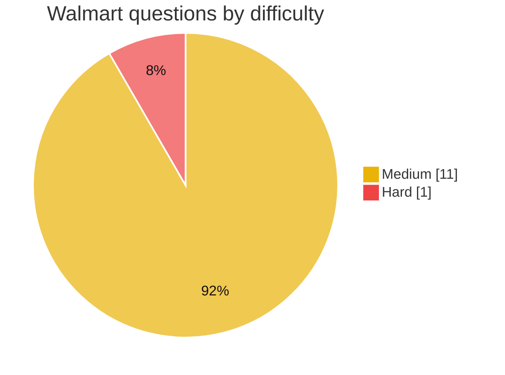

[← All companies](../README.md) · [Most asked across companies](../most-asked.md)

# Walmart Coding Questions

   

**12 Walmart coding questions** — 11 medium and 1 hard. Each one links to a free page where you can solve it in 13 languages, with hints and an editorial.

12 problems the CodeKairo catalogue tags as commonly asked in Walmart's coding rounds — 11 medium and 1 hard — each judged by hidden tests in 13 languages. The most common topics among them are Arrays (8), Hash Table (5) and Sorting (3). The tag is the catalogue's own annotation of where a problem tends to come up — not a list published by Walmart, which CodeKairo is not affiliated with.

**Practise on CodeKairo:** [All 12 Walmart questions](https://codekairo.com/challenges/company/walmart?utm_source=github)

## Contents

- [Start with these 10](#start-with-these-10)
- [Topics Walmart asks most](#topics-walmart-asks-most)
- 🟡 [Medium (11)](#medium-11)
- 🔴 [Hard (1)](#hard-1)

## Start with these 10

The Walmart questions most other companies ask too — the patterns worth knowing first.

1. 🟡 [Subdomain Visit Count](https://codekairo.com/problems/subdomain-visit-count?utm_source=github) — also asked at 4 other companies
2. 🟡 [Diagonal Traverse](https://codekairo.com/problems/diagonal-traverse?utm_source=github) — also asked at 3 other companies
3. 🟡 [Minimum Swaps to Group All 1's Together II](https://codekairo.com/problems/minimum-swaps-to-group-all-1s-together-ii?utm_source=github) — also asked at 3 other companies
4. 🟡 [Most Beautiful Item for Each Query](https://codekairo.com/problems/most-beautiful-item-for-each-query?utm_source=github) — also asked at 3 other companies
5. 🟡 [Number of Pairs of Interchangeable Rectangles](https://codekairo.com/problems/number-of-pairs-of-interchangeable-rectangles?utm_source=github) — also asked at 2 other companies
6. 🟡 [Equal Row and Column Pairs](https://codekairo.com/problems/equal-row-and-column-pairs?utm_source=github) — also asked at 2 other companies
7. 🟡 [Minimum Moves to Reach Target Score](https://codekairo.com/problems/minimum-moves-to-reach-target-score?utm_source=github) — also asked at 2 other companies
8. 🟡 [Partition Array Such That Maximum Difference Is K](https://codekairo.com/problems/partition-array-such-that-maximum-difference-is-k?utm_source=github) — also asked at 2 other companies
9. 🟡 [Find All Groups of Farmland](https://codekairo.com/problems/find-all-groups-of-farmland?utm_source=github) — also asked at 2 other companies
10. 🟡 [Top View of Binary Tree](https://codekairo.com/problems/top-view-of-binary-tree?utm_source=github) — also asked at 2 other companies

## Topics Walmart asks most

[Arrays](https://codekairo.com/challenges/arrays?utm_source=github) (8) · [Hash Table](https://codekairo.com/challenges/hash-table?utm_source=github) (5) · [Breadth-First Search](https://codekairo.com/challenges/breadth-first-search?utm_source=github) (3) · [Greedy](https://codekairo.com/challenges/greedy?utm_source=github) (3) · [Matrix](https://codekairo.com/challenges/matrix?utm_source=github) (3) · [Sorting](https://codekairo.com/challenges/sorting?utm_source=github) (3) · [Counting](https://codekairo.com/challenges/counting?utm_source=github) (2) · [Math](https://codekairo.com/challenges/math?utm_source=github) (2) · [Simulation](https://codekairo.com/challenges/simulation?utm_source=github) (2) · [Trees](https://codekairo.com/challenges/trees?utm_source=github) (2)

## Medium (11)

| # | Question | Topics | Acceptance |
|---:|---|---|---:|
| 276 | 🟡 [Diagonal Traverse](https://codekairo.com/problems/diagonal-traverse?utm_source=github) | Arrays, Matrix, Simulation | — |
| 674 | 🟡 [Number of Pairs of Interchangeable Rectangles](https://codekairo.com/problems/number-of-pairs-of-interchangeable-rectangles?utm_source=github) | Arrays, Hash Table, Math | — |
| 677 | 🟡 [Equal Row and Column Pairs](https://codekairo.com/problems/equal-row-and-column-pairs?utm_source=github) | Hash Table, Matrix, Simulation | — |
| 709 | 🟡 [Minimum Moves to Reach Target Score](https://codekairo.com/problems/minimum-moves-to-reach-target-score?utm_source=github) | Math, Greedy | — |
| 764 | 🟡 [Partition Array Such That Maximum Difference Is K](https://codekairo.com/problems/partition-array-such-that-maximum-difference-is-k?utm_source=github) | Arrays, Greedy, Sorting | — |
| 801 | 🟡 [Minimum Swaps to Group All 1's Together II](https://codekairo.com/problems/minimum-swaps-to-group-all-1s-together-ii?utm_source=github) | Arrays, Sliding Window | — |
| 906 | 🟡 [Find All Groups of Farmland](https://codekairo.com/problems/find-all-groups-of-farmland?utm_source=github) | Arrays, Matrix, Depth-First Search | — |
| 966 | 🟡 [Most Beautiful Item for Each Query](https://codekairo.com/problems/most-beautiful-item-for-each-query?utm_source=github) | Arrays, Binary Search, Sorting | — |
| 1208 | 🟡 [Subdomain Visit Count](https://codekairo.com/problems/subdomain-visit-count?utm_source=github) | Arrays, Hash Table, Strings | — |
| 1963 | 🟡 [Top View of Binary Tree](https://codekairo.com/problems/top-view-of-binary-tree?utm_source=github) | Trees, Breadth-First Search, Hash Table | — |
| 1964 | 🟡 [Bottom View of Binary Tree](https://codekairo.com/problems/bottom-view-of-binary-tree?utm_source=github) | Trees, Breadth-First Search, Hash Table | — |

## Hard (1)

| # | Question | Topics | Acceptance |
|---:|---|---|---:|
| 1467 | 🔴 [Minimum Number of Operations to Make Arrays Similar](https://codekairo.com/problems/minimum-number-of-operations-to-make-arrays-similar?utm_source=github) | Arrays, Greedy, Sorting | — |

---

[← All companies](../README.md) · Rebuilt every night from [codekairo.com](https://codekairo.com/challenges/company/walmart?utm_source=github). Last refreshed: November 2026. ⭐ [Star the repo](https://github.com/ayaanp14/company-wise-coding-questions) if it helps.
