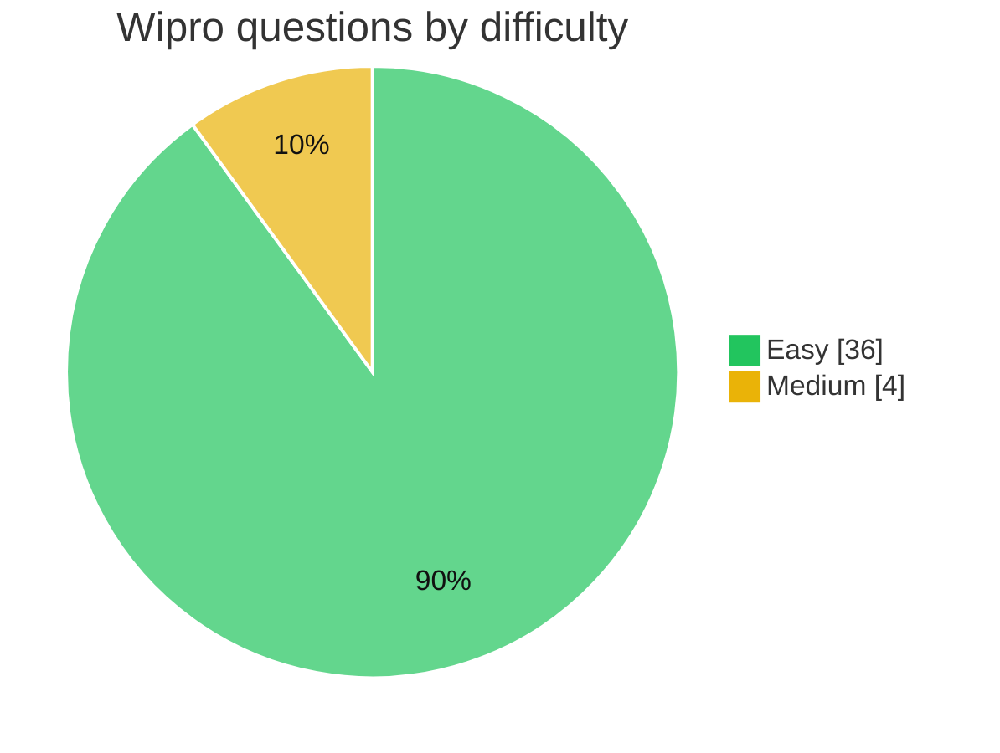

[← All companies](../README.md) · [Most asked across companies](../most-asked.md)

# Wipro Coding Questions

   

**40 Wipro coding questions** — 36 easy and 4 medium. Each one links to a free page where you can solve it in 13 languages, with hints and an editorial.

40 problems the CodeKairo catalogue tags as commonly asked in Wipro's coding rounds — 36 easy and 4 medium, no hard ones — each judged by hidden tests in 13 languages. The most common topics among them are Arrays (22), Strings (13) and Math (12). CodeKairo's Wipro NLTH — Aptitude mock covers the aptitude block of Wipro's National Level Talent Hunt (NLTH), the quickest services paper in this catalogue at under a minute a question. The tag is the catalogue's own annotation of where a problem tends to come up — not a list published by Wipro, which CodeKairo is not affiliated with.

**Practise on CodeKairo:** [All 40 Wipro questions](https://codekairo.com/challenges/company/wipro?utm_source=github) · [Wipro NLTH — Aptitude mock test](https://codekairo.com/tests/wipro-nlth-aptitude?utm_source=github) · [Wipro NLTH — Programming mock test](https://codekairo.com/tests/wipro-nlth-programming?utm_source=github) · [Wipro hiring process, round by round](https://codekairo.com/simulations/wipro?utm_source=github)

## Contents

- [Start with these 10](#start-with-these-10)
- [Topics Wipro asks most](#topics-wipro-asks-most)
- 🟢 [Easy (36)](#easy-36)
- 🟡 [Medium (4)](#medium-4)

## Start with these 10

The Wipro questions most other companies ask too — the patterns worth knowing first.

1. 🟢 [Fibonacci Number](https://codekairo.com/problems/fibonacci-number?utm_source=github) — also asked at 7 other companies
2. 🟢 [Armstrong Number](https://codekairo.com/problems/armstrong-number?utm_source=github) — also asked at 6 other companies
3. 🟢 [Second Largest Element](https://codekairo.com/problems/second-largest-element?utm_source=github) — also asked at 4 other companies
4. 🟡 [Minimum Number of Platforms](https://codekairo.com/problems/minimum-number-of-platforms?utm_source=github) — also asked at 4 other companies
5. 🟢 [Strong Number](https://codekairo.com/problems/strong-number?utm_source=github) — also asked at 3 other companies
6. 🟢 [Prime Factorisation](https://codekairo.com/problems/prime-factors?utm_source=github) — also asked at 3 other companies
7. 🟢 [Left Rotate an Array by D Places](https://codekairo.com/problems/left-rotate-array-by-d?utm_source=github) — also asked at 3 other companies
8. 🟢 [Count Pairs With Given Sum](https://codekairo.com/problems/count-pairs-with-given-sum?utm_source=github) — also asked at 3 other companies
9. 🟢 [The Employee That Worked on the Longest Task](https://codekairo.com/problems/the-employee-that-worked-on-the-longest-task?utm_source=github) — also asked at 3 other companies
10. 🟢 [Neon Number](https://codekairo.com/problems/neon-number?utm_source=github) — also asked at 2 other companies

## Topics Wipro asks most

[Arrays](https://codekairo.com/challenges/arrays?utm_source=github) (22) · [Strings](https://codekairo.com/challenges/strings?utm_source=github) (13) · [Math](https://codekairo.com/challenges/math?utm_source=github) (12) · [Two Pointers](https://codekairo.com/challenges/two-pointers?utm_source=github) (6) · [Hash Table](https://codekairo.com/challenges/hash-table?utm_source=github) (5) · [Greedy](https://codekairo.com/challenges/greedy?utm_source=github) (3) · [Sorting](https://codekairo.com/challenges/sorting?utm_source=github) (3) · [Bit Manipulation](https://codekairo.com/challenges/bit-manipulation?utm_source=github) (2) · [Counting](https://codekairo.com/challenges/counting?utm_source=github) (2) · [Number Theory](https://codekairo.com/challenges/number-theory?utm_source=github) (2)

## Easy (36)

| # | Question | Topics | Acceptance |
|---:|---|---|---:|
| 164 | 🟢 [Fibonacci Number](https://codekairo.com/problems/fibonacci-number?utm_source=github) | Math, Dynamic Programming, Recursion | — |
| 166 | 🟢 [Armstrong Number](https://codekairo.com/problems/armstrong-number?utm_source=github) | Math | — |
| 167 | 🟢 [Strong Number](https://codekairo.com/problems/strong-number?utm_source=github) | Math | — |
| 169 | 🟢 [Neon Number](https://codekairo.com/problems/neon-number?utm_source=github) | Math | — |
| 173 | 🟢 [Prime Factorisation](https://codekairo.com/problems/prime-factors?utm_source=github) | Math, Number Theory | — |
| 177 | 🟢 [Subtract the Product and Sum of Digits of an Integer](https://codekairo.com/problems/subtract-product-and-sum-of-digits?utm_source=github) | Math | — |
| 190 | 🟢 [Shuffle the Array](https://codekairo.com/problems/shuffle-the-array?utm_source=github) | Arrays | — |
| 222 | 🟢 [Defanging an IP Address](https://codekairo.com/problems/defanging-an-ip-address?utm_source=github) | Strings | — |
| 230 | 🟢 [Number of Segments in a String](https://codekairo.com/problems/number-of-segments-in-a-string?utm_source=github) | Strings | — |
| 475 | 🟢 [Second Largest Element](https://codekairo.com/problems/second-largest-element?utm_source=github) | Arrays | — |
| 504 | 🟢 [Count Equal and Divisible Pairs in an Array](https://codekairo.com/problems/count-equal-and-divisible-pairs-in-an-array?utm_source=github) | Arrays | — |
| 506 | 🟢 [Chocolate Distribution Problem](https://codekairo.com/problems/chocolate-distribution-problem?utm_source=github) | Arrays, Sorting, Sliding Window | — |
| 517 | 🟢 [Check If a Word Occurs As a Prefix of Any Word in a Sentence](https://codekairo.com/problems/check-if-a-word-occurs-as-a-prefix-of-any-word-in-a-sentence?utm_source=github) | Strings | — |
| 534 | 🟢 [Largest 3-Same-Digit Number in String](https://codekairo.com/problems/largest-3-same-digit-number-in-string?utm_source=github) | Strings | — |
| 603 | 🟢 [Find the Distinct Difference Array](https://codekairo.com/problems/find-the-distinct-difference-array?utm_source=github) | Arrays, Hash Table, Prefix Sum | — |
| 615 | 🟢 [Convert Array Into Zig-Zag Fashion](https://codekairo.com/problems/convert-array-into-zig-zag-fashion?utm_source=github) | Arrays, Greedy | — |
| 624 | 🟢 [Left Rotate an Array by D Places](https://codekairo.com/problems/left-rotate-array-by-d?utm_source=github) | Arrays, Two Pointers | — |
| 627 | 🟢 [Count Pairs With Given Sum](https://codekairo.com/problems/count-pairs-with-given-sum?utm_source=github) | Arrays, Hash Table | — |
| 633 | 🟢 [Check If String Is a Prefix of Array](https://codekairo.com/problems/check-if-string-is-a-prefix-of-array?utm_source=github) | Strings, Arrays | — |
| 637 | 🟢 [Count the Number of Vowel Strings in Range](https://codekairo.com/problems/count-the-number-of-vowel-strings-in-range?utm_source=github) | Strings, Arrays | — |
| 661 | 🟢 [Check if All Characters Have Equal Number of Occurrences](https://codekairo.com/problems/check-if-all-characters-have-equal-number-of-occurrences?utm_source=github) | Hash Table, Strings, Counting | — |
| 667 | 🟢 [Check if The Number is Fascinating](https://codekairo.com/problems/check-if-the-number-is-fascinating?utm_source=github) | Math, Hash Table, Strings | — |
| 690 | 🟢 [Number of Even and Odd Bits](https://codekairo.com/problems/number-of-even-and-odd-bits?utm_source=github) | Bit Manipulation, Math | — |
| 694 | 🟢 [Sum of Squares of Special Elements](https://codekairo.com/problems/sum-of-squares-of-special-elements?utm_source=github) | Arrays, Math, Number Theory | — |
| 720 | 🟢 [Complement of Base 10 Integer](https://codekairo.com/problems/complement-of-base-10-integer?utm_source=github) | Bit Manipulation, Math | — |
| 750 | 🟢 [Find the Distance Value Between Two Arrays](https://codekairo.com/problems/find-the-distance-value-between-two-arrays?utm_source=github) | Arrays, Two Pointers, Binary Search | — |
| 755 | 🟢 [Count Number of Pairs With Absolute Difference K](https://codekairo.com/problems/count-number-of-pairs-with-absolute-difference-k?utm_source=github) | Arrays, Hash Table, Counting | — |
| 782 | 🟢 [Defuse the Bomb](https://codekairo.com/problems/defuse-the-bomb?utm_source=github) | Arrays, Sliding Window, Simulation | — |
| 849 | 🟢 [Alternating Digit Sum](https://codekairo.com/problems/alternating-digit-sum?utm_source=github) | Math | — |
| 930 | 🟢 [Find Champion II](https://codekairo.com/problems/find-champion-ii?utm_source=github) | Graph | — |
| 982 | 🟢 [Minimum Time Visiting All Points](https://codekairo.com/problems/minimum-time-visiting-all-points?utm_source=github) | Arrays, Math, Geometry | — |
| 992 | 🟢 [Neither Minimum nor Maximum](https://codekairo.com/problems/neither-minimum-nor-maximum?utm_source=github) | Arrays, Sorting | — |
| 1007 | 🟢 [Count the Number of Incremovable Subarrays I](https://codekairo.com/problems/count-the-number-of-incremovable-subarrays-i?utm_source=github) | Arrays, Two Pointers, Enumeration | — |
| 1015 | 🟢 [Count Prefixes of a Given String](https://codekairo.com/problems/count-prefixes-of-a-given-string?utm_source=github) | Arrays, Strings | — |
| 1020 | 🟢 [Circular Sentence](https://codekairo.com/problems/circular-sentence?utm_source=github) | Strings | — |
| 1073 | 🟢 [The Employee That Worked on the Longest Task](https://codekairo.com/problems/the-employee-that-worked-on-the-longest-task?utm_source=github) | Arrays | — |

## Medium (4)

| # | Question | Topics | Acceptance |
|---:|---|---|---:|
| 373 | 🟡 [Minimum Number of Platforms](https://codekairo.com/problems/minimum-number-of-platforms?utm_source=github) | Arrays, Greedy, Sorting | — |
| 650 | 🟡 [Minimum Length of String After Deleting Similar Ends](https://codekairo.com/problems/minimum-length-of-string-after-deleting-similar-ends?utm_source=github) | Strings, Two Pointers | — |
| 773 | 🟡 [Sentence Similarity III](https://codekairo.com/problems/sentence-similarity-iii?utm_source=github) | Strings, Two Pointers, Arrays | — |
| 843 | 🟡 [Minimum Number of Operations to Move All Balls to Each Box](https://codekairo.com/problems/minimum-number-of-operations-to-move-all-balls-to-each-box?utm_source=github) | Arrays, Strings, Prefix Sum | — |

---

[← All companies](../README.md) · Rebuilt every night from [codekairo.com](https://codekairo.com/challenges/company/wipro?utm_source=github). Last refreshed: November 2026. ⭐ [Star the repo](https://github.com/ayaanp14/company-wise-coding-questions) if it helps.
