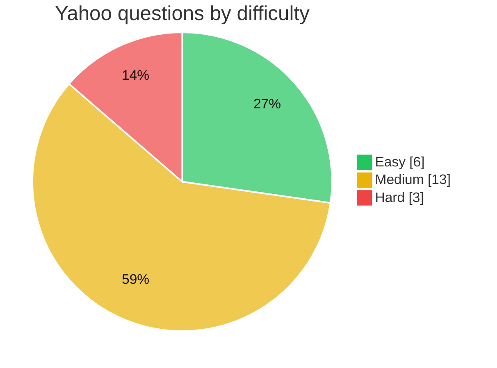

[← All companies](../README.md) · [Most asked across companies](../most-asked.md)

# Yahoo Coding Questions

   

**22 Yahoo coding questions** — 6 easy, 13 medium and 3 hard. Each one links to a free page where you can solve it in 13 languages, with hints and an editorial.

22 problems the CodeKairo catalogue tags as commonly asked in Yahoo's coding rounds — 6 easy, 13 medium and 3 hard — each judged by hidden tests in 13 languages. The most common topics among them are Arrays (12), Strings (9) and Hash Table (6). Tagged for Yahoo and no other company: Find Peak Element. The tag is the catalogue's own annotation of where a problem tends to come up — not a list published by Yahoo, which CodeKairo is not affiliated with.

**Practise on CodeKairo:** [All 22 Yahoo questions](https://codekairo.com/challenges/company/yahoo?utm_source=github)

## Contents

- [Start with these 10](#start-with-these-10)
- [Topics Yahoo asks most](#topics-yahoo-asks-most)
- 🟢 [Easy (6)](#easy-6)
- 🟡 [Medium (13)](#medium-13)
- 🔴 [Hard (3)](#hard-3)

## Start with these 10

The Yahoo questions most other companies ask too — the patterns worth knowing first.

1. 🟢 [Two Sum](https://codekairo.com/problems/two-sum?utm_source=github) — also asked at 18 other companies
2. 🟢 [Valid Parentheses](https://codekairo.com/problems/valid-parentheses?utm_source=github) — also asked at 14 other companies
3. 🟡 [Word Search](https://codekairo.com/problems/word-search?utm_source=github) — also asked at 8 other companies
4. 🟡 [Spiral Matrix](https://codekairo.com/problems/spiral-matrix?utm_source=github) — also asked at 7 other companies
5. 🔴 [Word Search II](https://codekairo.com/problems/word-search-ii?utm_source=github) — also asked at 7 other companies
6. 🟢 [Roman to Integer](https://codekairo.com/problems/roman-to-integer?utm_source=github) — also asked at 6 other companies
7. 🔴 [Integer to English Words](https://codekairo.com/problems/integer-to-english-words?utm_source=github) — also asked at 6 other companies
8. 🟡 [Decode String](https://codekairo.com/problems/decode-string?utm_source=github) — also asked at 5 other companies
9. 🟡 [Top K Frequent Elements](https://codekairo.com/problems/top-k-frequent-elements?utm_source=github) — also asked at 5 other companies
10. 🟡 [Meeting Rooms II](https://codekairo.com/problems/meeting-rooms-ii?utm_source=github) — also asked at 5 other companies

## Topics Yahoo asks most

[Arrays](https://codekairo.com/challenges/arrays?utm_source=github) (12) · [Strings](https://codekairo.com/challenges/strings?utm_source=github) (9) · [Hash Table](https://codekairo.com/challenges/hash-table?utm_source=github) (6) · [Backtracking](https://codekairo.com/challenges/backtracking?utm_source=github) (5) · [Matrix](https://codekairo.com/challenges/matrix?utm_source=github) (5) · [Math](https://codekairo.com/challenges/math?utm_source=github) (4) · [Binary Search](https://codekairo.com/challenges/binary-search?utm_source=github) (2) · [Bit Manipulation](https://codekairo.com/challenges/bit-manipulation?utm_source=github) (2) · [Heap](https://codekairo.com/challenges/heap?utm_source=github) (2) · [Recursion](https://codekairo.com/challenges/recursion?utm_source=github) (2)

## Easy (6)

| # | Question | Topics | Acceptance |
|---:|---|---|---:|
| 1 | 🟢 [Two Sum](https://codekairo.com/problems/two-sum?utm_source=github) | Arrays, Hash Table | — |
| 4 | 🟢 [Valid Parentheses](https://codekairo.com/problems/valid-parentheses?utm_source=github) | Strings, Stack | — |
| 28 | 🟢 [Longest Common Prefix](https://codekairo.com/problems/longest-common-prefix?utm_source=github) | Strings | — |
| 159 | 🟢 [Roman to Integer](https://codekairo.com/problems/roman-to-integer?utm_source=github) | Hash Table, Math, Strings | — |
| 305 | 🟢 [Matrix Cells in Distance Order](https://codekairo.com/problems/matrix-cells-in-distance-order?utm_source=github) | Arrays, Math, Matrix | — |
| 429 | 🟢 [Binary Number with Alternating Bits](https://codekairo.com/problems/binary-number-with-alternating-bits?utm_source=github) | Bit Manipulation | — |

## Medium (13)

| # | Question | Topics | Acceptance |
|---:|---|---|---:|
| 21 | 🟡 [Subarray Sum Equals K](https://codekairo.com/problems/subarray-sum-equals-k?utm_source=github) | Arrays, Hash Table, Prefix Sum | — |
| 58 | 🟡 [Search in Rotated Sorted Array](https://codekairo.com/problems/search-in-rotated-sorted-array?utm_source=github) | Arrays, Binary Search | — |
| 60 | 🟡 [Find Peak Element](https://codekairo.com/problems/find-peak-element?utm_source=github) | Arrays, Binary Search | — |
| 74 | 🟡 [Decode String](https://codekairo.com/problems/decode-string?utm_source=github) | Strings, Stack, Recursion | — |
| 93 | 🟡 [Word Break](https://codekairo.com/problems/word-break?utm_source=github) | Strings, Dynamic Programming, Hash Table | — |
| 102 | 🟡 [Top K Frequent Elements](https://codekairo.com/problems/top-k-frequent-elements?utm_source=github) | Arrays, Heap, Hash Table | — |
| 110 | 🟡 [Spiral Matrix](https://codekairo.com/problems/spiral-matrix?utm_source=github) | Arrays, Matrix, Simulation | — |
| 126 | 🟡 [Meeting Rooms II](https://codekairo.com/problems/meeting-rooms-ii?utm_source=github) | Arrays, Sorting, Heap | — |
| 148 | 🟡 [Combination Sum](https://codekairo.com/problems/combination-sum?utm_source=github) | Arrays, Backtracking | — |
| 450 | 🟡 [Shortest Path in Binary Matrix](https://codekairo.com/problems/shortest-path-in-binary-matrix?utm_source=github) | Arrays, Breadth-First Search, Matrix | — |
| 473 | 🟡 [Word Search](https://codekairo.com/problems/word-search?utm_source=github) | Arrays, Strings, Backtracking | — |
| 1200 | 🟡 [Restore IP Addresses](https://codekairo.com/problems/restore-ip-addresses?utm_source=github) | Strings, Backtracking | — |
| 1592 | 🟡 [Non-decreasing Subsequences](https://codekairo.com/problems/non-decreasing-subsequences?utm_source=github) | Arrays, Hash Table, Backtracking | — |

## Hard (3)

| # | Question | Topics | Acceptance |
|---:|---|---|---:|
| 1251 | 🔴 [Integer to English Words](https://codekairo.com/problems/integer-to-english-words?utm_source=github) | Strings, Math, Recursion | — |
| 1311 | 🔴 [Largest Palindrome Product](https://codekairo.com/problems/largest-palindrome-product?utm_source=github) | Math, Enumeration | — |
| 1573 | 🔴 [Word Search II](https://codekairo.com/problems/word-search-ii?utm_source=github) | Strings, Backtracking, Trie | — |

---

[← All companies](../README.md) · Rebuilt every night from [codekairo.com](https://codekairo.com/challenges/company/yahoo?utm_source=github). Last refreshed: November 2026. ⭐ [Star the repo](https://github.com/ayaanp14/company-wise-coding-questions) if it helps.
