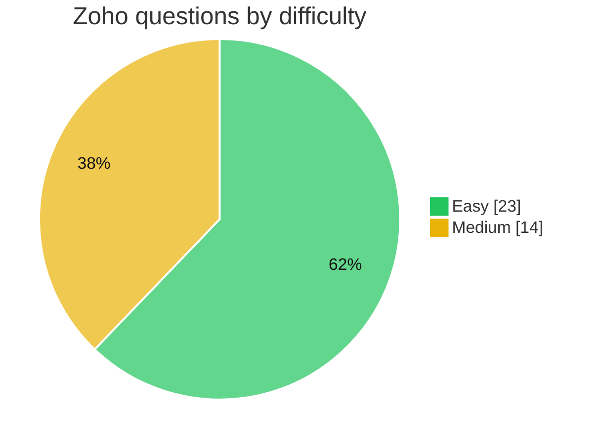

[← All companies](../README.md) · [Most asked across companies](../most-asked.md)

# Zoho Coding Questions

   

**37 Zoho coding questions** — 23 easy and 14 medium. Each one links to a free page where you can solve it in 13 languages, with hints and an editorial.

37 problems the CodeKairo catalogue tags as commonly asked in Zoho's coding rounds — 23 easy and 14 medium, no hard ones — each judged by hidden tests in 13 languages. The most common topics among them are Arrays (20), Math (11) and Strings (10). CodeKairo's Zoho — Round 1 mock covers the Zoho Round 1 pattern, which tests depth rather than speed: generous time for hard aptitude questions, then C output prediction. The tag is the catalogue's own annotation of where a problem tends to come up — not a list published by Zoho, which CodeKairo is not affiliated with.

**Practise on CodeKairo:** [All 37 Zoho questions](https://codekairo.com/challenges/company/zoho?utm_source=github) · [Zoho — Round 1 mock test](https://codekairo.com/tests/zoho-round-one?utm_source=github) · [Zoho hiring process, round by round](https://codekairo.com/simulations/zoho?utm_source=github)

## Contents

- [Start with these 10](#start-with-these-10)
- [Topics Zoho asks most](#topics-zoho-asks-most)
- 🟢 [Easy (23)](#easy-23)
- 🟡 [Medium (14)](#medium-14)

## Start with these 10

The Zoho questions most other companies ask too — the patterns worth knowing first.

1. 🟢 [Excel Sheet Column Title](https://codekairo.com/problems/excel-sheet-column-title?utm_source=github) — also asked at 5 other companies
2. 🟢 [Power of Two](https://codekairo.com/problems/power-of-two?utm_source=github) — also asked at 4 other companies
3. 🟢 [Excel Sheet Column Number](https://codekairo.com/problems/excel-sheet-column-number?utm_source=github) — also asked at 4 other companies
4. 🟢 [Count Pairs With Given Sum](https://codekairo.com/problems/count-pairs-with-given-sum?utm_source=github) — also asked at 3 other companies
5. 🟡 [Count Alternating Subarrays](https://codekairo.com/problems/count-alternating-subarrays?utm_source=github) — also asked at 3 other companies
6. 🟡 [Number of Ways to Select Buildings](https://codekairo.com/problems/number-of-ways-to-select-buildings?utm_source=github) — also asked at 3 other companies
7. 🟡 [Rotating the Box](https://codekairo.com/problems/rotating-the-box?utm_source=github) — also asked at 3 other companies
8. 🟢 [Reverse Words in a String III](https://codekairo.com/problems/reverse-words-in-a-string-iii?utm_source=github) — also asked at 2 other companies
9. 🟢 [Merge Strings Alternately](https://codekairo.com/problems/merge-strings-alternately?utm_source=github) — also asked at 2 other companies
10. 🟢 [Check if All Characters Have Equal Number of Occurrences](https://codekairo.com/problems/check-if-all-characters-have-equal-number-of-occurrences?utm_source=github) — also asked at 2 other companies

## Topics Zoho asks most

[Arrays](https://codekairo.com/challenges/arrays?utm_source=github) (20) · [Math](https://codekairo.com/challenges/math?utm_source=github) (11) · [Strings](https://codekairo.com/challenges/strings?utm_source=github) (10) · [Greedy](https://codekairo.com/challenges/greedy?utm_source=github) (8) · [Hash Table](https://codekairo.com/challenges/hash-table?utm_source=github) (8) · [Simulation](https://codekairo.com/challenges/simulation?utm_source=github) (6) · [Two Pointers](https://codekairo.com/challenges/two-pointers?utm_source=github) (6) · [Bit Manipulation](https://codekairo.com/challenges/bit-manipulation?utm_source=github) (5) · [Sliding Window](https://codekairo.com/challenges/sliding-window?utm_source=github) (4) · [Sorting](https://codekairo.com/challenges/sorting?utm_source=github) (4)

## Easy (23)

| # | Question | Topics | Acceptance |
|---:|---|---|---:|
| 154 | 🟢 [Power of Two](https://codekairo.com/problems/power-of-two?utm_source=github) | Math, Bit Manipulation | — |
| 157 | 🟢 [Excel Sheet Column Number](https://codekairo.com/problems/excel-sheet-column-number?utm_source=github) | Math, Strings | — |
| 158 | 🟢 [Excel Sheet Column Title](https://codekairo.com/problems/excel-sheet-column-title?utm_source=github) | Math, Strings | — |
| 211 | 🟢 [Reverse Words in a String III](https://codekairo.com/problems/reverse-words-in-a-string-iii?utm_source=github) | Two Pointers, Strings | — |
| 229 | 🟢 [Sorting the Sentence](https://codekairo.com/problems/sorting-the-sentence?utm_source=github) | Strings, Sorting | — |
| 254 | 🟢 [Merge Strings Alternately](https://codekairo.com/problems/merge-strings-alternately?utm_source=github) | Two Pointers, Strings | — |
| 604 | 🟢 [Sum of Values at Indices With K Set Bits](https://codekairo.com/problems/sum-of-values-at-indices-with-k-set-bits?utm_source=github) | Arrays, Bit Manipulation | — |
| 608 | 🟢 [Minimum Operations to Collect Elements](https://codekairo.com/problems/minimum-operations-to-collect-elements?utm_source=github) | Arrays, Hash Table, Simulation | — |
| 627 | 🟢 [Count Pairs With Given Sum](https://codekairo.com/problems/count-pairs-with-given-sum?utm_source=github) | Arrays, Hash Table | — |
| 661 | 🟢 [Check if All Characters Have Equal Number of Occurrences](https://codekairo.com/problems/check-if-all-characters-have-equal-number-of-occurrences?utm_source=github) | Hash Table, Strings, Counting | — |
| 664 | 🟢 [Largest Unique Number](https://codekairo.com/problems/largest-unique-number?utm_source=github) | Hash Table, Arrays, Sorting | — |
| 693 | 🟢 [Count Distinct Numbers on Board](https://codekairo.com/problems/count-distinct-numbers-on-board?utm_source=github) | Math, Simulation, Number Theory | — |
| 696 | 🟢 [Check if Number Has Equal Digit Count and Digit Value](https://codekairo.com/problems/check-if-number-has-equal-digit-count-and-digit-value?utm_source=github) | Hash Table, Strings, Counting | — |
| 721 | 🟢 [Maximum Strong Pair XOR I](https://codekairo.com/problems/maximum-strong-pair-xor-i?utm_source=github) | Bit Manipulation, Arrays, Trie | — |
| 728 | 🟢 [Shortest Subarray With OR at Least K I](https://codekairo.com/problems/shortest-subarray-with-or-at-least-k-i?utm_source=github) | Bit Manipulation, Arrays, Sliding Window | — |
| 751 | 🟢 [Two Sum Less Than K](https://codekairo.com/problems/two-sum-less-than-k?utm_source=github) | Arrays, Two Pointers, Sorting | — |
| 755 | 🟢 [Count Number of Pairs With Absolute Difference K](https://codekairo.com/problems/count-number-of-pairs-with-absolute-difference-k?utm_source=github) | Arrays, Hash Table, Counting | — |
| 784 | 🟢 [Count Subarrays of Length Three With a Condition](https://codekairo.com/problems/count-subarrays-of-length-three-with-a-condition?utm_source=github) | Arrays, Sliding Window | — |
| 851 | 🟢 [Maximum Difference by Remapping a Digit](https://codekairo.com/problems/maximum-difference-by-remapping-a-digit?utm_source=github) | Math, Greedy | — |
| 987 | 🟢 [Find the Integer Added to Array I](https://codekairo.com/problems/find-the-integer-added-to-array-i?utm_source=github) | Arrays, Math | — |
| 999 | 🟢 [Number of Bit Changes to Make Two Integers Equal](https://codekairo.com/problems/number-of-bit-changes-to-make-two-integers-equal?utm_source=github) | Bit Manipulation | — |
| 1016 | 🟢 [Decode the Message](https://codekairo.com/problems/decode-the-message?utm_source=github) | Hash Table, Strings | — |
| 1076 | 🟢 [Find the Losers of the Circular Game](https://codekairo.com/problems/find-the-losers-of-the-circular-game?utm_source=github) | Arrays, Hash Table, Simulation | — |

## Medium (14)

| # | Question | Topics | Acceptance |
|---:|---|---|---:|
| 612 | 🟡 [Subarray With Given Sum](https://codekairo.com/problems/subarray-with-given-sum?utm_source=github) | Arrays, Sliding Window, Two Pointers | — |
| 768 | 🟡 [Most Profit Assigning Work](https://codekairo.com/problems/most-profit-assigning-work?utm_source=github) | Arrays, Two Pointers, Greedy | — |
| 790 | 🟡 [K Radius Subarray Averages](https://codekairo.com/problems/k-radius-subarray-averages?utm_source=github) | Arrays, Sliding Window, Prefix Sum | — |
| 830 | 🟡 [Divide Chocolate](https://codekairo.com/problems/divide-chocolate?utm_source=github) | Arrays, Binary Search, Greedy | — |
| 844 | 🟡 [Removing Minimum and Maximum From Array](https://codekairo.com/problems/removing-minimum-and-maximum-from-array?utm_source=github) | Arrays, Greedy | — |
| 855 | 🟡 [Maximum Split of Positive Even Integers](https://codekairo.com/problems/maximum-split-of-positive-even-integers?utm_source=github) | Math, Greedy | — |
| 863 | 🟡 [Minimum Additions to Make Valid String](https://codekairo.com/problems/minimum-additions-to-make-valid-string?utm_source=github) | Strings, Greedy, Dynamic Programming | — |
| 872 | 🟡 [Count Alternating Subarrays](https://codekairo.com/problems/count-alternating-subarrays?utm_source=github) | Arrays, Math, Dynamic Programming | — |
| 877 | 🟡 [Number of Ways to Select Buildings](https://codekairo.com/problems/number-of-ways-to-select-buildings?utm_source=github) | Strings, Dynamic Programming, Prefix Sum | — |
| 889 | 🟡 [Find the N-th Value After K Seconds](https://codekairo.com/problems/find-the-n-th-value-after-k-seconds?utm_source=github) | Arrays, Math, Simulation | — |
| 902 | 🟡 [Maximum Matrix Sum](https://codekairo.com/problems/maximum-matrix-sum?utm_source=github) | Arrays, Matrix, Greedy | — |
| 907 | 🟡 [Rotating the Box](https://codekairo.com/problems/rotating-the-box?utm_source=github) | Arrays, Matrix, Two Pointers | — |
| 960 | 🟡 [Maximum Score From Removing Stones](https://codekairo.com/problems/maximum-score-from-removing-stones?utm_source=github) | Math, Greedy, Heap | — |
| 1000 | 🟡 [Water Bottles II](https://codekairo.com/problems/water-bottles-ii?utm_source=github) | Math, Simulation | — |

---

[← All companies](../README.md) · Rebuilt every night from [codekairo.com](https://codekairo.com/challenges/company/zoho?utm_source=github). Last refreshed: November 2026. ⭐ [Star the repo](https://github.com/ayaanp14/company-wise-coding-questions) if it helps.
