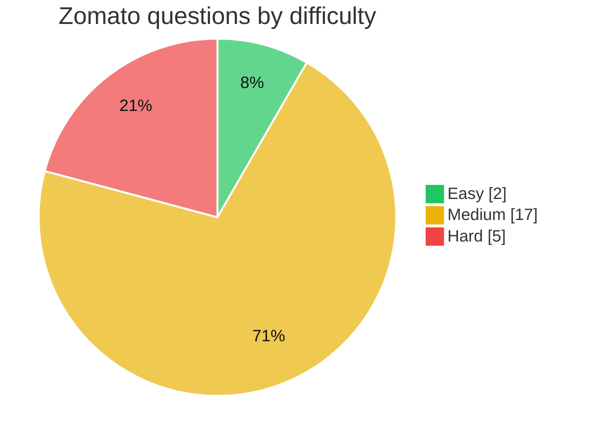

[← All companies](../README.md) · [Most asked across companies](../most-asked.md)

# Zomato Coding Questions

   

**24 Zomato coding questions** — 2 easy, 17 medium and 5 hard. Each one links to a free page where you can solve it in 13 languages, with hints and an editorial.

24 problems the CodeKairo catalogue tags as commonly asked in Zomato's coding rounds — 2 easy, 17 medium and 5 hard — each judged by hidden tests in 13 languages. The most common topics among them are Arrays (17), Hash Table (6) and Strings (5). Tagged for Zomato and no other company: Single Element in a Sorted Array and Move Zeroes. The tag is the catalogue's own annotation of where a problem tends to come up — not a list published by Zomato, which CodeKairo is not affiliated with.

**Practise on CodeKairo:** [All 24 Zomato questions](https://codekairo.com/challenges/company/zomato?utm_source=github)

## Contents

- [Start with these 10](#start-with-these-10)
- [Topics Zomato asks most](#topics-zomato-asks-most)
- 🟢 [Easy (2)](#easy-2)
- 🟡 [Medium (17)](#medium-17)
- 🔴 [Hard (5)](#hard-5)

## Start with these 10

The Zomato questions most other companies ask too — the patterns worth knowing first.

1. 🟡 [Longest Substring Without Repeating Characters](https://codekairo.com/problems/longest-substring-without-repeating-characters?utm_source=github) — also asked at 13 other companies
2. 🟡 [Merge Intervals](https://codekairo.com/problems/merge-intervals?utm_source=github) — also asked at 12 other companies
3. 🟡 [Number of Islands](https://codekairo.com/problems/number-of-islands?utm_source=github) — also asked at 9 other companies
4. 🔴 [The Skyline Problem](https://codekairo.com/problems/the-skyline-problem?utm_source=github) — also asked at 7 other companies
5. 🟡 [Maximum Subarray](https://codekairo.com/problems/maximum-subarray?utm_source=github) — also asked at 6 other companies
6. 🟡 [Container With Most Water](https://codekairo.com/problems/container-with-most-water?utm_source=github) — also asked at 6 other companies
7. 🟡 [Maximal Square](https://codekairo.com/problems/maximal-square?utm_source=github) — also asked at 5 other companies
8. 🟡 [Snakes and Ladders](https://codekairo.com/problems/snakes-and-ladders?utm_source=github) — also asked at 4 other companies
9. 🟡 [Search a 2D Matrix II](https://codekairo.com/problems/search-a-2d-matrix-ii?utm_source=github) — also asked at 4 other companies
10. 🟡 [Combination Sum](https://codekairo.com/problems/combination-sum?utm_source=github) — also asked at 3 other companies

## Topics Zomato asks most

[Arrays](https://codekairo.com/challenges/arrays?utm_source=github) (17) · [Hash Table](https://codekairo.com/challenges/hash-table?utm_source=github) (6) · [Matrix](https://codekairo.com/challenges/matrix?utm_source=github) (5) · [Strings](https://codekairo.com/challenges/strings?utm_source=github) (5) · [Breadth-First Search](https://codekairo.com/challenges/breadth-first-search?utm_source=github) (4) · [Dynamic Programming](https://codekairo.com/challenges/dynamic-programming?utm_source=github) (4) · [Divide and Conquer](https://codekairo.com/challenges/divide-and-conquer?utm_source=github) (3) · [Greedy](https://codekairo.com/challenges/greedy?utm_source=github) (3) · [Backtracking](https://codekairo.com/challenges/backtracking?utm_source=github) (2) · [Binary Search](https://codekairo.com/challenges/binary-search?utm_source=github) (2)

## Easy (2)

| # | Question | Topics | Acceptance |
|---:|---|---|---:|
| 13 | 🟢 [Move Zeroes](https://codekairo.com/problems/move-zeroes?utm_source=github) | Arrays, Two Pointers | — |
| 34 | 🟢 [Isomorphic Strings](https://codekairo.com/problems/isomorphic-strings?utm_source=github) | Strings, Hash Table | — |

## Medium (17)

| # | Question | Topics | Acceptance |
|---:|---|---|---:|
| 8 | 🟡 [Maximum Subarray](https://codekairo.com/problems/maximum-subarray?utm_source=github) | Arrays, Dynamic Programming, Divide and Conquer | — |
| 29 | 🟡 [Longest Substring Without Repeating Characters](https://codekairo.com/problems/longest-substring-without-repeating-characters?utm_source=github) | Strings, Sliding Window, Hash Table | — |
| 44 | 🟡 [Container With Most Water](https://codekairo.com/problems/container-with-most-water?utm_source=github) | Arrays, Two Pointers, Greedy | — |
| 64 | 🟡 [Single Element in a Sorted Array](https://codekairo.com/problems/single-element-in-a-sorted-array?utm_source=github) | Arrays, Binary Search | — |
| 118 | 🟡 [Number of Islands](https://codekairo.com/problems/number-of-islands?utm_source=github) | Arrays, Matrix, Depth-First Search | — |
| 122 | 🟡 [Merge Intervals](https://codekairo.com/problems/merge-intervals?utm_source=github) | Arrays, Sorting, Intervals | — |
| 137 | 🟡 [Course Schedule](https://codekairo.com/problems/course-schedule?utm_source=github) | Graph, Topological Sort, Depth-First Search | — |
| 146 | 🟡 [Permutations](https://codekairo.com/problems/permutations?utm_source=github) | Arrays, Backtracking | — |
| 148 | 🟡 [Combination Sum](https://codekairo.com/problems/combination-sum?utm_source=github) | Arrays, Backtracking | — |
| 290 | 🟡 [Maximal Square](https://codekairo.com/problems/maximal-square?utm_source=github) | Arrays, Dynamic Programming, Matrix | — |
| 408 | 🟡 [Single Number III](https://codekairo.com/problems/single-number-iii?utm_source=github) | Arrays, Bit Manipulation | — |
| 471 | 🟡 [Snakes and Ladders](https://codekairo.com/problems/snakes-and-ladders?utm_source=github) | Arrays, Breadth-First Search, Matrix | — |
| 651 | 🟡 [Number of Good Ways to Split a String](https://codekairo.com/problems/number-of-good-ways-to-split-a-string?utm_source=github) | Strings, Hash Table, Prefix Sum | — |
| 680 | 🟡 [Optimal Partition of String](https://codekairo.com/problems/optimal-partition-of-string?utm_source=github) | Hash Table, Strings, Greedy | — |
| 800 | 🟡 [Length of Longest Subarray With at Most K Frequency](https://codekairo.com/problems/length-of-longest-subarray-with-at-most-k-frequency?utm_source=github) | Arrays, Hash Table, Sliding Window | — |
| 828 | 🟡 [Search a 2D Matrix II](https://codekairo.com/problems/search-a-2d-matrix-ii?utm_source=github) | Arrays, Matrix, Binary Search | — |
| 1046 | 🟡 [Number of Ways to Divide a Long Corridor](https://codekairo.com/problems/number-of-ways-to-divide-a-long-corridor?utm_source=github) | Math, Strings, Dynamic Programming | — |

## Hard (5)

| # | Question | Topics | Acceptance |
|---:|---|---|---:|
| 25 | 🔴 [First Missing Positive](https://codekairo.com/problems/first-missing-positive?utm_source=github) | Arrays, Hash Table | — |
| 924 | 🔴 [Minimum Moves to Spread Stones Over Grid](https://codekairo.com/problems/minimum-moves-to-spread-stones-over-grid?utm_source=github) | Arrays, Matrix, Dynamic Programming | — |
| 1425 | 🔴 [The Skyline Problem](https://codekairo.com/problems/the-skyline-problem?utm_source=github) | Arrays, Divide and Conquer, Heap | — |
| 1434 | 🔴 [Maximum Spending After Buying Items](https://codekairo.com/problems/maximum-spending-after-buying-items?utm_source=github) | Arrays, Greedy, Sorting | — |
| 1538 | 🔴 [Shortest Cycle in a Graph](https://codekairo.com/problems/shortest-cycle-in-a-graph?utm_source=github) | Graph, Breadth-First Search | — |

---

[← All companies](../README.md) · Rebuilt every night from [codekairo.com](https://codekairo.com/challenges/company/zomato?utm_source=github). Last refreshed: November 2026. ⭐ [Star the repo](https://github.com/ayaanp14/company-wise-coding-questions) if it helps.
